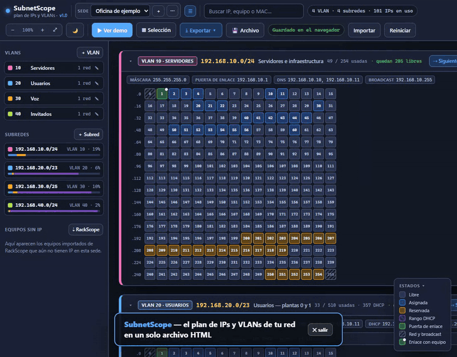
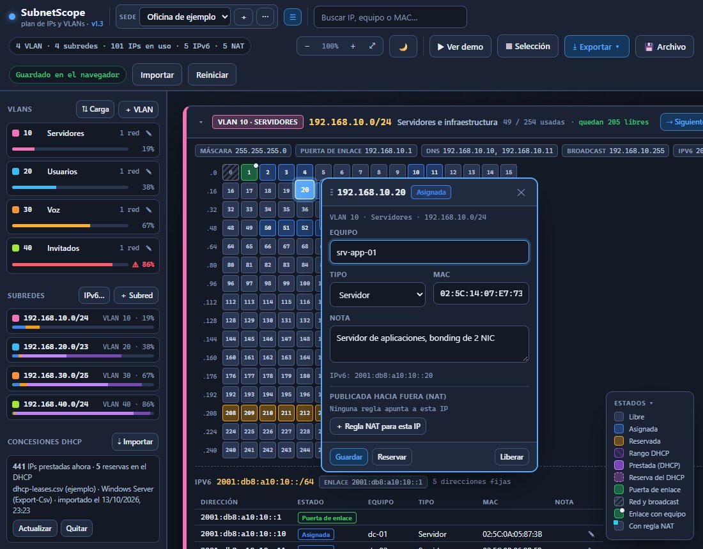

***Español** · [English](README.en.md)*

# SubnetScope

**Planifica las IPs y VLANs de tu red en un solo archivo HTML.** Sin servidor, sin instalación y sin que salga un dato de tu equipo.

Qué IP tiene cada equipo, en qué VLAN está y cuántas te quedan libres. Un único archivo `index.html` que se abre con doble clic en cualquier navegador.

Nació para sustituir la típica hoja de cálculo de direccionamiento: la que nunca está al día, en la que hay que filtrar para encontrar una IP libre y donde nadie apunta los rangos reservados. Aquí cada subred se ve como una cuadrícula, una casilla por IP, y lo libre se ve a simple vista.

Es la herramienta hermana de **[RackScope](https://github.com/marcosblg/rackscope)**, que documenta el cableado de los racks. Puedes importar en SubnetScope los equipos que ya tengas en RackScope y darles IP sin volver a teclearlos.

### 👉 [Pruébalo ahora en el navegador](https://marcosblg.github.io/subnetscope/)

> 🆕 **v1.4** (14 de octubre de 2026): deshacer con Ctrl+Z. Viene de la v1.3: reservas del DHCP con su dueño aunque el equipo no esté encendido, y el pool leído del propio servidor. Con un `/export` de MikroTik sale todo de golpe. [Ver las novedades](CHANGELOG.md)

No hay que instalar ni descargar nada: el enlace abre la herramienta con una oficina de ejemplo. Pulsa **▶ Ver demo** para la visita guiada.

🎬 **[Ver el vídeo de demostración (30 s)](docs/demo.mp4)** · o pulsa **▶ Ver demo** dentro de la propia aplicación para recorrerla tú mismo.

## Qué hace

**VLANs y subredes**
- VLANs con ID, nombre, color y descripción.
- Subredes en notación CIDR, de /16 a /30, cada una asociada a su VLAN, con puerta de enlace, DNS y rango DHCP opcionales.
- Comprueba que el CIDR es correcto (si escribes `192.168.1.5/24` te propone `192.168.1.0/24`) y **avisa si dos subredes se solapan**.
- Propone la primera IP útil como puerta de enlace al crear una subred.
- **Dividir una subred** en partes iguales (una /23 en dos /24, una /24 en cuatro /26…): la vista previa hace de calculadora y, si la aplicas, reparte las IPs, la puerta de enlace y el rango DHCP.

**Una casilla por IP**
- Cada subred se dibuja como una cuadrícula y cada casilla tiene el color de su estado: libre, asignada, reservada, rango DHCP, puerta de enlace, red y broadcast.
- Las subredes mayores de /24 se parten en **bloques /24 plegables**, cada uno con su recuento y su barra de uso.
- **Clic en una casilla** y se abre su ficha: nombre del equipo, tipo (servidor, switch, impresora, PC, cámara, AP, VM u otro), MAC y nota, con botones para asignar, reservar o liberar.
- Al pasar el ratón por encima ya sale un aviso rápido con la IP y el equipo.
- La ficha se arrastra por su cabecera si tapa la casilla que quieres ver.
- Avisa si repites una MAC o un nombre de equipo en otra IP.
- **Historial por IP**: quién la tuvo, cuándo se asignó, se reservó o se liberó.

**Saber qué te queda**
- Contador por subred: *"87 / 254 usadas · quedan 167 libres"*, descontando el rango DHCP.
- Botón **Siguiente IP libre** en cada subred: te lleva a ella y abre la ficha.
- **Buscador** por IP, nombre de equipo o MAC, que resalta la casilla y despliega su bloque.
- **Selección múltiple** (clic, arrastrar o Shift+clic) para reservar o liberar rangos enteros de golpe.

**Servidor DHCP: concesiones, reservas y pool**
- Importa lo que exportes de tu servidor DHCP:
  - **MikroTik**: el `/export` del router (pool, concesiones y reservas de una vez), `/ip dhcp-server lease export` o `print detail`.
  - **Windows Server**: `Get-DhcpServerv4Lease`, `Get-DhcpServerv4Reservation` o `Get-DhcpServerv4Scope` con `Export-Csv`.
  - **pfSense / Linux**: `dhcpd.leases` y `dhcpd.conf`.
  - **Kea**: `kea-dhcp4.conf` o el CSV de concesiones. O un CSV con IP, MAC, nombre y caducidad.
- Las **reservas** del servidor (IPs estáticas en el DHCP) salen como "Reserva del DHCP" con su dueño, estén en uso o no, dentro o fuera del pool.
- El **pool** del servidor se propone como rango DHCP de cada subred, enseñando antes la diferencia con lo documentado.
- Las IPs prestadas se pintan en la cuadrícula con su equipo, su MAC y la fecha de caducidad, y "Siguiente IP libre" se las salta.
- Avisa si el DHCP ha prestado una IP que tienes documentada como fija para otro equipo, y si las concesiones llevan más de un día sin actualizarse.
- No se conecta al servidor: exportas, importas y listo.

**Carga por VLAN**
- Cada VLAN muestra su porcentaje de IPs ocupadas (asignadas, reservadas, enlace y prestadas) y se pueden ordenar de más a menos cargada, con aviso a partir del 80 %.

**IPv6 en doble pila**
- Cada subred puede llevar su **prefijo IPv6** y su puerta de enlace IPv6 junto al IPv4.
- Lista de **direcciones IPv6 fijas** por subred, con la misma ficha de siempre: equipo, tipo, MAC y nota. En IPv6 no se dibuja una casilla por IP (un /64 son 18 trillones): se apuntan solo las fijas.
- **Plan IPv6**: le das el /48 o /56 del operador y propone un /64 para cada subred, usando el ID de VLAN cuando se puede (VLAN 10 → …:10::/64). Sirve también de calculadora de prefijos.

**Reglas NAT**
- Documenta qué se publica hacia Internet: IP y puerto públicos → IP interna, con protocolo y descripción.
- Las IPs publicadas llevan una marca en la cuadrícula y su ficha muestra sus reglas.
- Avisa si dos reglas usan el mismo puerto público o si una apunta a una IP sin documentar.
- Solo se documentan: SubnetScope no se conecta al firewall.

**Sedes o redes**
- Desplegable de sedes: cada una con sus VLANs y subredes, independientes.

**Traer los equipos de RackScope**
- Importa el JSON exportado de RackScope y saca la lista de equipos (sin paneles de parcheo ni huecos).
- Los que ya tienen una IP escrita en RackScope que cae en una de tus subredes se asignan solos; el resto queda en la lista **Equipos sin IP**, desde donde les das IP con un clic.
- Y al revés: **Exportar › Pasar las IPs a RackScope** escribe en el subtítulo de cada equipo de un JSON de RackScope la IP que tiene aquí, para que las dos herramientas no se desincronicen. Genera un archivo nuevo; el tuyo no se toca.

**Sacar la documentación fuera**
- **CSV** para Excel con todas las IPs asignadas y reservadas, IPv4 e IPv6, y otro con las reglas NAT.
- **PDF** con la tabla de VLANs, el resumen de subredes y, por cada subred, su cuadrícula y el listado de IPs.
- Imagen **PNG** de las cuadrículas.
- **JSON** de copia de seguridad.
- Todo ello de una sede o de todas a la vez.

## Cómo se usa

1. Descarga `index.html` y ábrelo con doble clic. También puedes probarlo sin descargar nada desde la demo en línea.
2. Pulsa **▶ Ver demo** para una visita guiada de 30 segundos por las funciones.
3. Viene con una oficina de ejemplo (VLANs de servidores, usuarios, voz e invitados) para trastear. Cuando quieras empezar en serio: **＋** en el desplegable de sedes → *en blanco*.
4. Crea las VLAN con **＋ VLAN** y las subredes con **＋ Subred** en el panel de la izquierda.
5. Pulsa **💾 Archivo** y elige un `.json` tuyo: a partir de ahí la aplicación lo reescribe sola cada vez que cambias algo.

## Dónde se guardan los datos

En tu equipo y en ningún sitio más. No hay servidor, no hay cuenta y no sale una sola petición a Internet. Se guarda en el almacenamiento local del navegador y, si vinculas un archivo, en ese `.json` que eliges tú.

Un aviso importante: el almacenamiento del navegador va atado a la ruta del archivo. Si mueves el HTML o te descargas otra copia en otra carpeta, ese almacén no viaja contigo. Por eso conviene vincular un archivo o exportar el JSON de vez en cuando. La aplicación avisa en rojo si detecta que el navegador no le deja guardar.

## Qué no hace (todavía)

SubnetScope es documentación manual: no escanea la red, no hace ping, no consulta SNMP y no configura ningún equipo (las reglas NAT, por ejemplo, solo se apuntan).

## Compatibilidad

Probado en navegadores basados en Chromium (Chrome y Edge). El guardado automático en archivo usa la File System Access API; donde no esté disponible, funciona igual con exportar e importar JSON.

## Estado

Proyecto personal, hecho para resolver un problema real de trabajo. Se publica por si le sirve a alguien más. Las sugerencias son bienvenidas: abre un *issue* contando qué necesitarías.

## Licencia

MIT. Haz lo que quieras con él.
